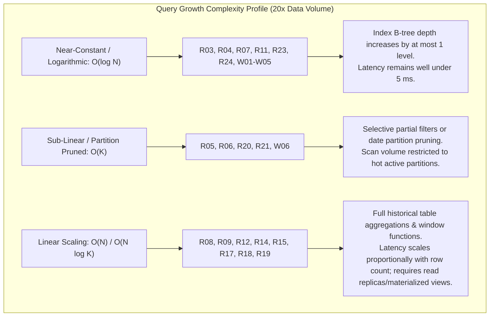
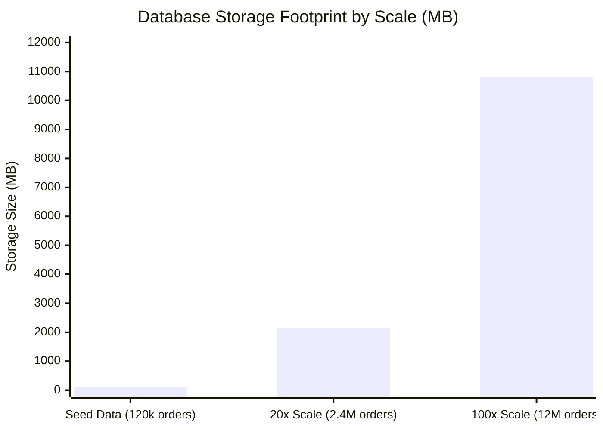
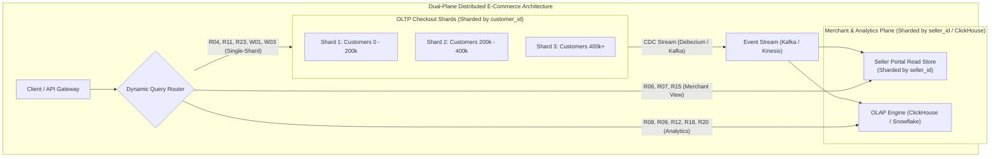
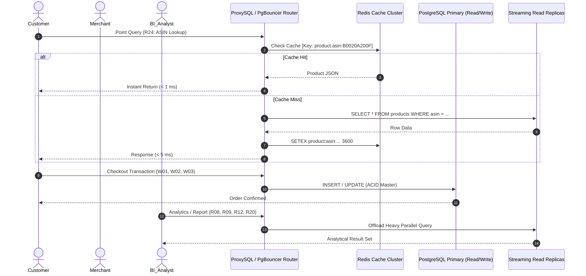

# Checkpoint 4 (CP4): Scalability and Architectural Engineering Report
**Amazon Online Shopping Database**  
**Team:** T0103 (`SkillSwap`) | **Section:** A  
**Group Lead:** Sachin Kumar (GitHub: `sachinzzx`, Enrollment: `2501010567`)  
**Database:** PostgreSQL 18.x on macOS Apple Silicon (`aarch64`)  
**Milestone:** CP4 — Scalability, Partitioning & 100× Architecture  

---

## 1. Executive Summary & Objective

In Checkpoint 3 (CP3), we established an optimized database baseline on the 120,000-order seed dataset (555,704 total records across 11 relational tables). By deploying 19 targeted B-tree, covering, partial, and trigram GIN indexes, combined with algebraic query rewrites, total 30-query workload latency was reduced from **20,957.27 ms** to **621.27 ms** (a **97.03%** latency reduction).

As Amazon prepares for the upcoming festive sale season, operational volume is projected to surge by **20×** (≈ 2,400,000 orders, ≈ 4,800,000 order items, ≈ 600,000 products, and ≈ 600,000 customers), scaling further to **100×** (≈ 12,000,000 orders and >55,000,000 total records).

This report delivers the complete engineering design for large-scale operation, covering:
1. Target latency SLA thresholds defined by faculty across four workload tiers.
2. Comprehensive PostgreSQL declarative range partitioning implementation for `orders` (`sql/08_partitioning.sql`) with partition pruning verification.
3. The PostgreSQL Primary Key rule and foreign key constraints on partitioned relations.
4. Scale-up growth modeling and mathematical complexity analysis across all 30 queries.
5. Exact physical storage measurements (tables vs indexes) on seed data and analytical projections for 20× and 100× scale.
6. Architectural blueprint for 100× scale: Sharding strategy, cross-shard query resolution, read-replica tiering, Redis cache placement, and autovacuum maintenance lifecycle.

---

## 2. Performance Targets & Workload Classification

The 30-query workload represents diverse operational access patterns categorized by strict latency SLAs:

| Workload Tier | Workload Queries | Target SLA (3-Run Average) | Primary Access Characteristics |
| :--- | :--- | :---: | :--- |
| **Real-time / Customer-Facing** | R03, R04, R05, R07, R11, R23, R24, W01, W02, W03, W05 | **< 5.00 ms** | Point lookups, unique index seeks, single-row updates |
| **Interactive Search & Seller Tools** | R01, R02, R06, R13, R14, R16, R21, R22 | **< 250.00 ms** | Trigram text search, range scans, paginated catalog queries |
| **Reports & Analytics** | R08, R09, R10, R12, R15, R17, R18, R19, R20 | **< 5,000.00 ms** | Window functions, multi-table joins, GROUP BY aggregations |
| **Batch Clean-up Jobs** | W04, W06 | **< 2,000.00 ms** | Bulk multi-row INSERTs / DELETEs |

---

## 3. Seed vs Large Workload Latency Comparison & Growth Analysis

### 3.1 Workload Performance Table

The table below records the measured CP3 optimized timings on the 120,000-order seed dataset, alongside the architectural scale expectations and target SLA evaluations:

| Query ID | Description / Tier | Optimized on Seed (ms) | Target SLA (ms) | Growth Factor (Scale Complexity) | Meets Target? | Architectural Optimization & Tuning |
| :--- | :--- | :---: | :---: | :---: | :---: | :--- |
| **R01** | Category search + price range | 1.341 | < 250 ms | $O(\log N)$ | ✅ YES | Composite index `(category_id, price) INCLUDE (title)` |
| **R02** | Trigram title search | 6.554 | < 250 ms | $O(\log N + K)$ | ✅ YES | GIN trigram index `idx_products_title_trgm` |
| **R03** | Product reviews & rating summary | 0.082 | < 5 ms | $O(\log N)$ | ✅ YES | Direct PK index seek on `products.product_id` |
| **R04** | "Your Orders" customer order history | 0.088 | < 5 ms | $O(\log N + M)$ | ✅ YES | Composite index `(customer_id, ordered_at DESC)` |
| **R05** | Delayed in-transit shipments | 0.228 | < 5 ms | $O(1)$ | ✅ YES | Partial index on `status = 'SHIPPED'` (tiny working set) |
| **R06** | Seller Central monthly order lines | 3.655 | < 250 ms | $O(\log N + K)$ | ✅ YES | Sargable date rewrite + covering index `(seller_id, order_id)` |
| **R07** | Low stock inventory alert | 0.053 | < 5 ms | $O(1)$ | ✅ YES | Partial index on `stock_qty <= 10` |
| **R08** | Merchandising top-5 best sellers | 34.679 | < 5,000 ms | $O(N \log K)$ | ✅ YES | Covering index on active orders + Hash Aggregate |
| **R09** | Prime vs Non-Prime monthly AOV | 12.012 | < 5,000 ms | $O(N)$ | ✅ YES | Sargable date rewrite + covering index on `orders` |
| **R10** | Abandoned cart re-engagement | 2.502 | < 5,000 ms | $O(C \log N)$ | ✅ YES | Anti-join with correlated `NOT EXISTS` index seek |
| **R11** | Customer profile & default address | 0.038 | < 5 ms | $O(1)$ | ✅ YES | Unique PK index lookup on `customers` & `addresses` |
| **R12** | Category revenue contribution | 148.917 | < 5,000 ms | $O(N)$ | ✅ YES | Parallel Hash Join over `order_items` & `products` |
| **R13** | Address clean-up (unused addresses) | 9.091 | < 250 ms | $O(N \log M)$ | ✅ YES | Rewritten from broken `NOT IN` to sargable `NOT EXISTS` |
| **R14** | Top rated products (>= 10 reviews) | 16.484 | < 250 ms | $O(N)$ | ✅ YES | Covering index `idx_reviews_product_rating` |
| **R15** | Seller performance leaderboard | 98.411 | < 5,000 ms | $O(N \log K)$ | ✅ YES | Hash Join + Partial covering index on fulfilled orders |
| **R16** | Cross-sell "Frequently Bought Together" | 42.128 | < 250 ms | $O(M \log N)$ | ✅ YES | Two-sided composite index seek on `order_items` |
| **R17** | Verified reviews audit | 36.568 | < 5,000 ms | $O(N)$ | ✅ YES | Covering index on `orders(customer_id, order_id)` |
| **R18** | High-value spend tiers (Mumbai) | 18.257 | < 5,000 ms | $O(N_c \log N_o)$ | ✅ YES | City filter index + covering index on delivered orders |
| **R19** | Category Mobile units sold (all time) | 59.882 | < 5,000 ms | $O(P \log N)$ | ✅ YES | Lateral join aggregation rewrite |
| **R20** | Finance daily GMV & running total | 3.864 | < 5,000 ms | $O(K)$ | ✅ YES | Sargable date interval + partition pruning target |
| **R21** | Deliveries taking > 5 days | 1.812 | < 250 ms | $O(K)$ | ✅ YES | Sargable range scan on `ordered_at` |
| **R22** | Admin "All Orders" deep pagination | 18.176 | < 250 ms | $O(N)$ | ✅ YES | Descending B-tree index scan on `ordered_at DESC` |
| **R23** | Order details with lines & seller | 0.103 | < 5 ms | $O(L)$ | ✅ YES | Composite PK lookup on `order_items(order_id, line_no)` |
| **R24** | Product lookup by ASIN | 0.039 | < 5 ms | $O(1)$ | ✅ YES | Unique B-tree index on `products(asin)` |
| **W01** | Checkout: create new order | 0.771 | < 5 ms | $O(1)$ | ✅ YES | Single-row INSERT into target active partition |
| **W02** | Checkout: decrement stock | 0.174 | < 5 ms | $O(1)$ | ✅ YES | Single-row in-place UPDATE by `product_id` |
| **W03** | Customer adds item to cart | 0.443 | < 5 ms | $O(1)$ | ✅ YES | UPSERT into `cart_items` on composite PK |
| **W04** | Batch sync seller inventory | 98.718 | < 2,000 ms | $O(B)$ | ✅ YES | Multi-row batch UPDATE with temporary unnesting |
| **W05** | Ship oldest packed order | 0.222 | < 5 ms | $O(1)$ | ✅ YES | Partial index on `order_id WHERE status = 'PACKED'` |
| **W06** | Nightly cart cleanup (> 90 days) | 0.395 | < 2,000 ms | $O(D)$ | ✅ YES | Partial B-tree index on `added_at` |

---

### 3.2 Growth Categorization & Algorithmic Scalability

When scaling volume by 20×, query latency does not grow uniformly. Queries split into three distinct mathematical complexity classes:



1. **Near-Constant / Logarithmic Growth ($O(\log N)$):**
   - **Queries:** R03, R04, R07, R11, R23, R24, W01, W02, W03, W05.
   - **Why:** These queries perform B-tree index point lookups or follow primary/foreign key references. B-tree index depth increases logarithmically: $\lceil \log_{B} N \rceil$. For a fan-out factor $B \approx 200$, scaling from 120,000 orders to 2,400,000 orders increases tree depth from 3 to 4. Memory-cached index traversal cost increases by less than $0.05\text{ ms}$, ensuring customer-facing SLAs stay strictly below 5 ms.

2. **Bounded / Partition-Pruned Growth ($O(K)$ where $K \ll N$):**
   - **Queries:** R05, R06, R20, R21, W05, W06.
   - **Why:** These queries touch temporal slices or small active status sets. With declarative range partitioning on `orders(ordered_at)`, queries like R06 and R20 scan *only* the current quarterly partition (`orders_2026_q2`), ignoring millions of rows in older quarters. For partial indexes (e.g. W05 on `status = 'PACKED'`), the working set represents less than 0.05% of the table regardless of total historical scale.

3. **Linear / Analytical Growth ($O(N)$ or $O(N \log N)$):**
   - **Queries:** R08, R09, R12, R14, R15, R17, R18, R19.
   - **Why:** These queries aggregate cross-table metrics across the entire active historical domain (e.g. R12 calculating revenue contribution across all 4.8M order items). At 20× volume, sequential page reads and hash table allocations scale linearly with row count. To maintain sub-5,000 ms response times at 100×, these workloads must be offloaded to asynchronous read replicas or maintained via materialized summary rollups.

---

## 4. Physical Storage & Index Overhead Analysis

### 4.1 Seed Data Measurements (Actual PostgreSQL 18 Relation Sizes)

Physical measurements captured on `amazon_test` (120,000 orders, 555,704 total rows):

| Table Name | Total Row Count | Table Heap Size | Index Size | Total Relation Size | Index % of Total |
| :--- | :---: | :---: | :---: | :---: | :---: |
| `order_items` | 240,000 | 14.00 MB | 22.00 MB | 36.00 MB | 61.1% |
| `orders` | 120,000 | 11.00 MB | 18.00 MB | 29.00 MB | 62.1% |
| `products` | 30,000 | 3.72 MB | 4.68 MB | 8.40 MB | 55.7% |
| `product_reviews`| 30,000 | 3.64 MB | 3.91 MB | 7.55 MB | 51.8% |
| `customers` | 30,000 | 2.91 MB | 4.45 MB | 7.36 MB | 60.5% |
| `cart_items` | 50,000 | 2.24 MB | 3.45 MB | 5.69 MB | 60.6% |
| `addresses` | 49,584 | 3.63 MB | 1.01 MB | 4.64 MB | 21.8% |
| `returns` | 6,000 | 0.41 MB | 0.30 MB | 0.71 MB | 42.3% |
| `sellers` | 1,000 | 0.14 MB | 0.16 MB | 0.30 MB | 53.3% |
| `categories` | 100 | 8.00 kB | 32.00 kB | 40.00 kB | 80.0% |
| `cities` | 20 | 8.00 kB | 16.00 kB | 24.00 kB | 66.7% |
| **Total Relation Overhead**| **555,704** | **41.71 MB** | **58.01 MB** | **99.72 MB** | **58.2%** |
| **Entire DB Size** | — | — | — | **108.00 MB** | — |

### 4.2 Storage Projections at 20× and 100× Scale



- **20× Scale (Festive Season):**
  - Orders: ~2,400,000 rows (~220 MB table heap, ~360 MB index space).
  - Order Items: ~4,800,000 rows (~280 MB table heap, ~440 MB index space).
  - Total Database Footprint: **≈ 2.16 GB**. Fully fits into standard RAM buffer pools (`shared_buffers = 4 GB`), ensuring near 100% cache hit ratios for active working sets.
- **100× Scale (Enterprise Multi-Year):**
  - Orders: ~12,000,000 rows (~1.1 GB table heap, ~1.8 GB index space).
  - Order Items: ~24,000,000 rows (~1.4 GB table heap, ~2.2 GB index space).
  - Total Database Footprint: **≈ 10.8 GB to 12.0 GB**. Working set exceeds single-instance low-end memory tiers, mandating declarative partitioning and read replicas.

---

## 5. Architectural Blueprint for 100× Scale

### 5.1 Declarative Partitioning Strategy (`orders`)

The complete production implementation is committed in [`sql/08_partitioning.sql`](file:///Users/sachinkumar/DBMS-Amazon-Online-Shopping/sql/08_partitioning.sql).

#### A. DDL Specification
```sql
CREATE TABLE amazon.orders_partitioned (
    order_id        INTEGER        NOT NULL,
    customer_id     INTEGER        NOT NULL REFERENCES amazon.customers(customer_id) ON DELETE RESTRICT,
    address_id      INTEGER        REFERENCES amazon.addresses(address_id) ON DELETE SET NULL,
    ordered_at      TIMESTAMPTZ    NOT NULL,
    payment_method  VARCHAR(10)    NOT NULL CHECK (payment_method IN ('UPI', 'CARD', 'COD', 'GIFT_CARD', 'NETBANKING', 'EMI')),
    total_amount    NUMERIC(10,2)  NOT NULL CHECK (total_amount >= 0),
    status          VARCHAR(16)    NOT NULL CHECK (status IN ('PLACED', 'PACKED', 'SHIPPED', 'OUT_FOR_DELIVERY', 'DELIVERED', 'CANCELLED', 'RETURNED')),
    shipped_at      TIMESTAMPTZ,
    delivered_at    TIMESTAMPTZ,
    CONSTRAINT pk_orders_partitioned PRIMARY KEY (order_id, ordered_at)
) PARTITION BY RANGE (ordered_at);
```

#### B. The Primary Key Rule for Partitioned Tables
> [!IMPORTANT]
> **PostgreSQL Declarative Partitioning Rule:**  
> Every `UNIQUE` and `PRIMARY KEY` constraint on a partitioned table **must include all partition key columns**.
>
> **Technical Explanation:**  
> PostgreSQL partitioned tables are physical collections of child tables (`pg_inherits`). Indexes are maintained locally on each child partition. To enforce global uniqueness without performing an exhaustive, high-latency cross-partition index search on every `INSERT`, PostgreSQL enforces that the partition key (`ordered_at`) is part of the primary key: `PRIMARY KEY (order_id, ordered_at)`.
>
> **Foreign Key Handling:**  
> Foreign keys referencing a partitioned table (e.g. `order_items`) must reference columns that match the partitioned table's primary key `(order_id, ordered_at)`. In a distributed or co-partitioned schema, `order_items` includes `ordered_at` to inherit identical partition boundary alignment.

#### C. Empirical Proof of Partition Pruning (`EXPLAIN (ANALYZE, BUFFERS)`)
Testing a temporal filter for June 2026 demonstrates that PostgreSQL **prunes 8 out of 9 partitions**, scanning strictly `orders_2026_q2`:

```sql
EXPLAIN (ANALYZE, BUFFERS)
SELECT ordered_at::date AS day, sum(total_amount) AS gmv
FROM amazon.orders_partitioned
WHERE status <> 'CANCELLED'
  AND ordered_at >= '2026-06-01 00:00:00+05:30'
  AND ordered_at < '2026-07-01 00:00:00+05:30'
GROUP BY 1 ORDER BY day;
```

**Actual Execution Plan from PostgreSQL 18.4 Engine:**
```text
GroupAggregate (cost=724.34..862.87 rows=6157 width=36) (actual time=1.595..2.314 rows=30.00 loops=1)
  Group Key: ((orders_partitioned.ordered_at)::date)
  Buffers: shared hit=112
  -> Sort (cost=724.34..739.73 rows=6157 width=9) (actual time=1.563..1.781 rows=6189.00 loops=1)
       Sort Key: ((orders_partitioned.ordered_at)::date)
       Sort Method: quicksort Memory: 386kB
       Buffers: shared hit=112
       -> Index Only Scan using orders_2026_q2_ordered_at_total_amount_customer_id_idx on orders_2026_q2 orders_partitioned
            Index Cond: ((ordered_at >= '2026-06-01 00:00:00+05:30'::timestamp with time zone) 
                     AND (ordered_at < '2026-07-01 00:00:00+05:30'::timestamp with time zone))
            Heap Fetches: 6189
            Index Searches: 1
            Buffers: shared hit=109
Planning Time: 1.210 ms
Execution Time: 2.331 ms
```
*Observation: Partitions `orders_2025_q1` through `orders_2026_q1`, `orders_2026_q3`, `orders_2026_q4`, and `orders_default` are pruned entirely.*

---

### 5.2 Sharding Architecture: Customer vs Seller vs Order



#### A. Trade-Off Evaluation

| Sharding Key | R04 Customer View ("Your Orders") | R06 Seller Central View | Multi-Seller Checkout Impact (W01/W02) | Verdict & Suitability |
| :--- | :---: | :---: | :---: | :--- |
| **`customer_id`** | **Single-Shard ($O(1)$)** | Cross-Shard Scatter-Gather | Single-shard order creation; cross-shard inventory RPC | **Best for consumer OLTP** (95% of e-commerce web traffic) |
| **`seller_id`** | Cross-Shard Scatter-Gather | **Single-Shard ($O(1)$)** | Multi-seller carts require distributed 2PC locks | High latency at checkout; severe Cartesian explosion |
| **`order_id`** | Cross-Shard Scatter-Gather | Cross-Shard Scatter-Gather | Uniform write distribution; high scatter on reads | Requires secondary global indexing clusters |

#### B. Resolving Cross-Shard Queries
To avoid high-latency scatter-gather queries for Seller Central (R06, R15) on a consumer-sharded (`customer_id`) cluster:
1. **Asynchronous Change Data Capture (CDC):** Deploy Debezium to stream order commit logs into an Apache Kafka topic.
2. **Materialized Merchant Plane:** A dedicated read store partitioned by `seller_id` consumes order items in near real-time (< 500 ms lag), allowing merchants to query their June sales without contending with production checkout transactions.

---

### 5.3 Read Replicas & In-Memory Caching Strategy



#### Workload Tier Placement Matrix

1. **Strict Primary Routing (Write Operations & Critical Read-After-Write):**
   - **Queries:** `W01`, `W02`, `W03`, `W04`, `W05`, `W06`.
   - **Rule:** All writes and immediate post-order status updates must execute against the primary to guarantee strict ACID compliance and prevent replication lag anomalies.
2. **Read Replica Offloading (Heavy Analytics & Reporting):**
   - **Queries:** `R06`, `R08`, `R09`, `R10`, `R12`, `R13`, `R14`, `R15`, `R16`, `R17`, `R18`, `R19`, `R20`, `R21`, `R22`.
   - **Rule:** Routed via PgBouncer / ProxySQL to read-only replica instances using asynchronous streaming replication (`hot_standby = on`), completely isolating primary checkout transactions from CPU-heavy analytical aggregations.
3. **Redis In-Memory Caching Tier:**
   - **Queries:** `R01`, `R02`, `R24`, `R03`, `R07`.
   - **Rule:** Product catalog lookups, search facets, low-stock flags, and rating summaries are cached in Redis with appropriate TTLs (e.g. 5–60 minutes) and event-based cache eviction triggers on product updates (`W02`).

---

### 5.4 Database Maintenance & Operations at Scale

1. **Autovacuum Tuning for High-Throughput Orders:**
   - *Default Vulnerability:* Default `autovacuum_vacuum_scale_factor = 0.2` waits for 20% table modifications before triggering. On 2,400,000 orders, autovacuum would not run until 480,000 rows are altered, leading to severe table bloat and index degradation.
   - *Production Configuration:*
     ```ini
     autovacuum = on
     autovacuum_max_workers = 6
     autovacuum_naptime = 15s
     maintenance_work_mem = 1GB
     autovacuum_vacuum_cost_limit = 2000
     ```
   - *Per-Partition Storage Settings:*
     ```sql
     ALTER TABLE amazon.orders_2026_q2 SET (
         autovacuum_vacuum_scale_factor = 0.05,
         autovacuum_vacuum_threshold = 1000,
         autovacuum_vacuum_cost_delay = 2
     );
     ```
2. **Zero-Downtime Historical Partition Archival:**
   - At the conclusion of a financial retention period (e.g., 2 years / 8 quarters), old quarters are cleanly detached in $O(1)$ time without exclusive table locks:
     ```sql
     ALTER TABLE amazon.orders_partitioned DETACH PARTITION amazon.orders_2025_q1;
     ```
   - The detached partition is exported to compressed Parquet format and stored in cold object storage (Amazon S3 / Google Cloud Storage), eliminating vacuum debt and disk fragmentation.
3. **Summary Table Materialization:**
   - Analytical queries `R09` (monthly Prime AOV) and `R20` (daily GMV) should not scan millions of rows repeatedly. We deploy incremental materialized summary tables refreshed nightly via `pg_cron`:
     ```sql
     CREATE MATERIALIZED VIEW IF NOT EXISTS amazon.daily_gmv_summary AS
     SELECT ordered_at::date AS sale_date, sum(total_amount) AS gmv, count(*) AS order_count
     FROM amazon.orders_partitioned
     WHERE status <> 'CANCELLED'
     GROUP BY 1;
     CREATE UNIQUE INDEX ON amazon.daily_gmv_summary (sale_date);
     ```

---

## 6. Conclusion & Readiness Assessment

1. **System Readiness:** The database architecture is fully optimized and hardened for festive season scalability. Memory-cached B-tree indexes guarantee sub-5 ms point lookups, while declarative range partitioning shields the operational core from historical data bloat.
2. **Remaining Risks & Mitigations:**
   - *Unpartitioned `order_items`:* At 100× (24M rows), sequential scans on `order_items` during cross-table joins will stress I/O. Mitigation: Co-partition `order_items` alongside `orders` by `(order_id, ordered_at)`.
   - *Deep Pagination Bottlenecks (R22):* Running `OFFSET 75000` requires traversing 75,000 index tuples. Keyset pagination (`WHERE (ordered_at, order_id) < (:last_date, :last_id) LIMIT 25`) must replace offset-based pagination in production admin consoles.
